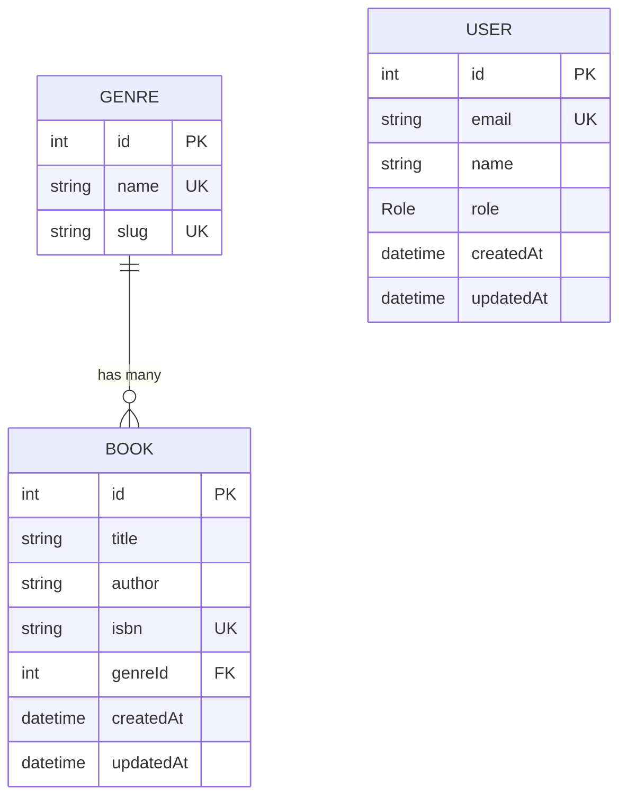

# 🐘 Ndovu Library

> _Ndovu_ is Swahili for elephant, an animal that never forgets. Ndovu Library is a catalogue of books about our heritage, technology, and the life of the African savanna.

This is the backend API for a library management system, built with **NestJS**, **Prisma**, and **PostgreSQL**. It is being built week by week as part of the PLP Full Stack Software Engineering programme.

## What it does right now

- Stores books, genres, and users in a hosted PostgreSQL database
- Ships with sample data: 4 genres and 16 books
- Serves the catalogue at `GET /books`, returning every book together with its genre

Planned next: full book CRUD, genres, user accounts, borrowing, and reviews.

## Tech stack

| Layer     | Tool                | Role                                                       |
| --------- | ------------------- | ---------------------------------------------------------- |
| Framework | NestJS              | Organises the code into modules, controllers, and services |
| Database  | PostgreSQL (hosted) | Stores the data in related tables                          |
| ORM       | Prisma              | Typed queries and migrations                               |
| Language  | TypeScript          | Type safety across the project                             |

## Getting started

1. Clone the repository and go into the API folder:
   ```bash
   git clone <your-repo-url>
   cd library-management-system/api
   ```
2. Install the dependencies:
   ```bash
   npm install
   ```
3. Create your environment file. Copy `.env.example` to `.env` and replace the placeholder with your own PostgreSQL connection string. Never commit `.env`.
4. Create the database tables:
   ```bash
   npx prisma migrate dev
   ```
5. Add the sample data:
   ```bash
   npx prisma db seed
   ```
6. Start the API:
   ```bash
   npm run start:dev
   ```
7. Open `http://localhost:3000/books` to see the catalogue.

Tip: `npx prisma studio` opens a browser view of your tables.

## Project structure

```
library-management-system/
├── README.md
└── api/
    ├── .env.example            # shows which settings are needed (no secrets)
    ├── prisma/
    │   ├── schema.prisma       # the data model: Role, User, Genre, Book
    │   ├── seed.ts             # sample genres and books
    │   └── migrations/         # history of every database change
    └── src/
        ├── prisma/             # PrismaService and PrismaModule
        └── books/              # books module, controller, service
```

## Data model



`Role` is an enum with two values: `PATRON` and `LIBRARIAN`.

## Schema Decisions

### Why Book references Genre instead of embedding it

Every `Book` stores only a `genreId`, a number that points to one row in the `Genre` table. It does not carry a copy of the genre's name. For example, all four books in "Savanna Conservation" point to the same genre row.

- **One source of truth.** The genre name exists in exactly one place. If "Savanna Conservation" is renamed, one row changes and every book in it reflects the change. With a copy inside each book, every record would need editing, and a single missed one would leave the catalogue contradicting itself.
- **The database guards the data.** Because `genreId` is a foreign key, PostgreSQL rejects any book that points to a genre that does not exist. Our migration uses `ON DELETE RESTRICT`, so a genre that still has books cannot be deleted by accident, and no book is ever left without a genre.
- **A genre is more than a label.** It has its own fields (`name` and a URL-friendly `slug`), so it can be listed, filtered, and extended later without touching a single book.
- **Fast lookups by genre.** "Show me all Wildlife & Safari books" becomes a search on one `genreId` value instead of comparing text across every book.
- **The trade-off.** Showing a book with its genre needs a join, which Prisma does with `include: { genre: true }`. This is a small cost, because each genre is shared by many books, and it is the reason `GET /books` returns the genre alongside every title.

### Other decisions

- **`Role` is an enum** (`PATRON`, `LIBRARIAN`), so the database itself refuses any other value. New users default to `PATRON`, the least-privileged role, so nobody becomes a librarian by accident.
- **Unique fields.** `User.email`, `Book.isbn`, and `Genre.name` / `Genre.slug` are `@unique`, because each one identifies exactly one real-world thing. This prevents duplicate accounts, duplicate catalogue entries, and two genres with the same name.
- **Slugs for genres.** A `slug` like `wildlife-safari` is safe to put in a URL, so a genre page can later be reached at a clean address without worrying about spaces or `&`.
- **Timestamps.** `createdAt` and `updatedAt` record when each row was added and last changed, which helps with debugging and later with sorting and audits.
- **Users are separate from books for now.** The two tables do not link yet. They will be connected when borrowing and reviews are added, so the schema grows one step at a time.

## Week 2: Catalog CRUD and Authentication

### Setup

1. `cd api && npm install`
2. In `api/.env` set `DATABASE_URL` and `JWT_SECRET`
3. `npx prisma migrate dev` then `npx prisma db seed`
4. `npm run start:dev` (API on http://localhost:3000)

### Endpoints

| Method              | Route                                | Access                    |
| ------------------- | ------------------------------------ | ------------------------- |
| POST                | /auth/register                       | Public (creates a PATRON) |
| POST                | /auth/login                          | Public (returns a JWT)    |
| GET                 | /books?genreId=&search=&page=&limit= | Public                    |
| GET                 | /books/:id                           | Public                    |
| POST, PATCH, DELETE | /books, /books/:id                   | LIBRARIAN only            |
| GET                 | /genres, /genres/:id                 | Public                    |
| POST, PATCH, DELETE | /genres, /genres/:id                 | LIBRARIAN only            |
| GET                 | /users/profile                       | Any logged-in user        |

### Test accounts (seeded, development only)

- Librarian: librarian@ndovulibrary.com / Librarian123!
- Patron: patron@ndovulibrary.com / Patron123!

### Design notes

- DTOs with class-validator and a global ValidationPipe (`whitelist: true`)
- Passwords hashed with bcrypt; JWT issued at login, verified by JwtStrategy
- RolesGuard + `@Roles()` decorator restrict write routes to librarians
- Postman collection: `docs/postman_collection.json`git add README.md 
